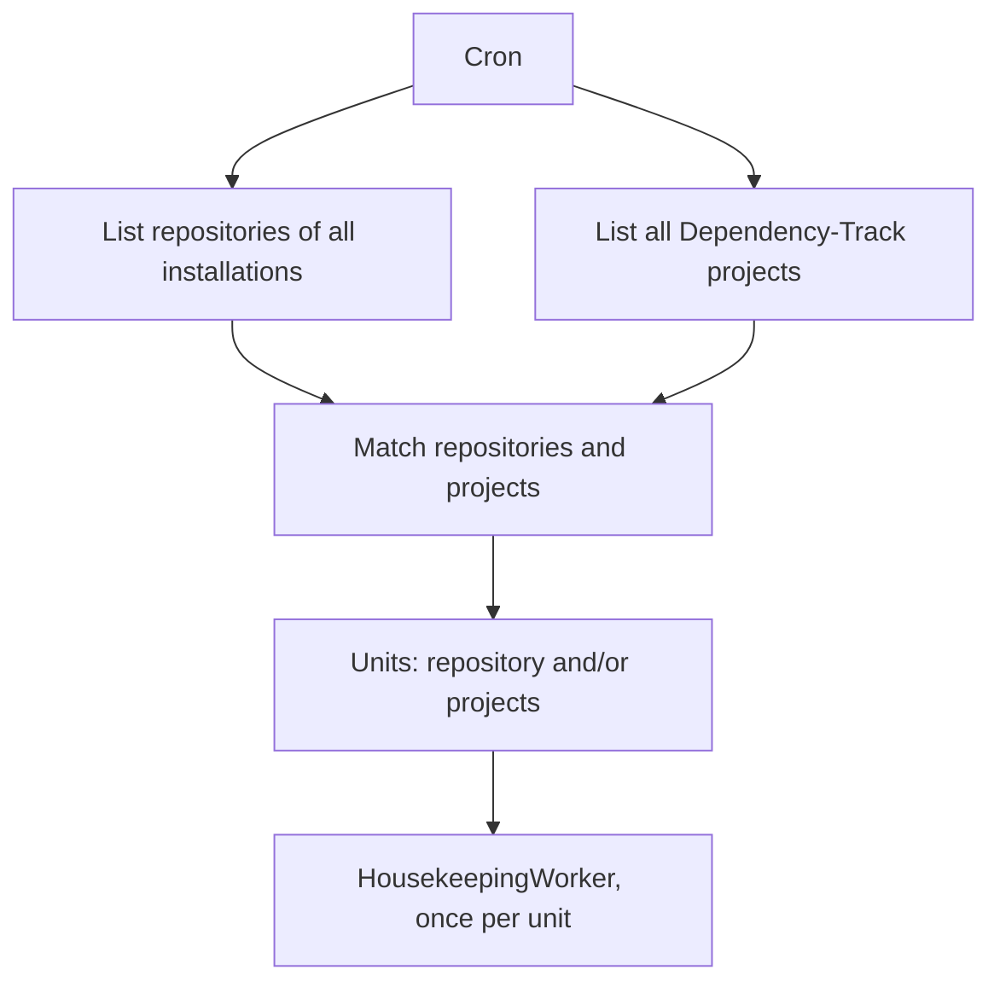

# Housekeeping

Besides reacting to GitHub webhook events, Technolinator can run a scheduled *housekeeping* across **all repositories of all installations** of its GitHub app and **all projects in Dependency-Track**.
It authenticates with the very same app credentials as the event handling, so no further secrets are needed and no webhook event is required.

The housekeeping is scheduled in-app, which is sufficient as long as Technolinator runs as a single replica.

## How a run works

A run is a **single walk-through**: every GitHub repository and every Dependency-Track project is looked at exactly once, and all housekeeping happens in one place, the `HousekeepingWorker`.



1. `GitHubRepositoryIndexer` lists the repositories of all non-suspended installations (installations in parallel), and `DependencyTrackClient` lists all projects (including archived ones). Both happen in parallel.
2. `UnitMatcher` pairs repositories with projects, using **the same matching as when uploading** (`RepositoryProjectMatcher`, which the event handling uses as well): a project belongs to a repository, if its name is the repository name or starts with `<repository>-`, and its VCS/website reference points to the repository (or it has no reference at all and is named exactly like the repository). Children of matched projects belong to the repository, too.
   On top of that, projects not matched to any repository follow their nearest matched ancestor in the Dependency-Track hierarchy, regardless of name and references, so a hierarchy is never split across units (Dependency-Track only archives parents without active children). A descendant matched to another repository on its own stays with that one.
3. Every result is a `HousekeepingUnit`, which is handed to the `HousekeepingWorker` exactly once. Units are processed in parallel (`APP_HOUSEKEEPING_WORKER_CONCURRENCY`).

### Units

| Unit                       | Repository state       | Meaning                                                                                                                         |
|----------------------------|------------------------|---------------------------------------------------------------------------------------------------------------------------------|
| repository and projects    | `ACTIVE` / `ARCHIVED`  | The regular case                                                                                                                |
| repository only            | `ACTIVE` / `ARCHIVED`  | The repository wasn't analyzed (yet), or its projects couldn't be matched                                                       |
| projects only              | `GONE`                 | The projects (or their nearest ancestor with a reference) reference exactly one repository, that certainly doesn't exist anymore (or was transferred to another account, which counts as the same) |
| projects only              | `MOVED`                | Like `GONE`, but the repository was renamed within its account. The unit knows the repository by its new name                  |
| projects only              | `UNKNOWN`              | No repository could be matched and nothing can be said: no or several references, accounts without installation of the app, a repository existing but named differently, or projects claimed by more than one repository ("contested", including their descendants) |

A repository is considered `GONE` only if all of the following holds:

* its owner has an installation with access to *all repositories*, the repository list was non-empty and doesn't contain it
* GitHub doesn't know it when looked up on its own with that installation, or redirects to a repository of another owner, which is a transfer. A repository renamed within its account is redirected to its new name: it's alive (and not necessarily archived), so it's `MOVED` instead, see [`follow-renamed-repositories`](#action-follow-renamed-repositories). A failing lookup makes it `UNKNOWN`
* no repository of the same name exists under another owner of the listings, which might be the transferred one. This makes a transfer to an account Technolinator is installed for `UNKNOWN` (and spares the projects, as the new owner's repository takes them over with its next analysis)

Repositories of installations restricted to *selected repositories* are never `GONE` if they're simply missing: a deleted repository can't be told apart from a deselected one. Only a redirect to another owner is certain.
The lookup is only done for repositories referenced by active projects (or their ancestors), as only those can get projects archived or renamed. Repositories having archived projects only aren't looked up, which saves GitHub requests for long-gone repositories in every run, and are `UNKNOWN` therefore.

### Reliability of the listings

The absence of a repository or project only means something if everything was listed:

* **Dependency-Track** is all or nothing: if a page can't be fetched (after retries), or fewer projects are returned than `X-Total-Count` announces, the run is aborted without processing any unit.
* **GitHub** is checked per installation: an installation whose repositories can't be listed completely (request error, timeout, rate limit handling failing, or fewer repositories returned than GitHub announces via `total_count`) is logged, counted in `housekeeping_installation_failures` and left out, so its repositories are `UNKNOWN`.
* If **any** installation failed, the lists aren't trustworthy as a whole, so only units with *a repository and projects* are processed (a project might belong to a repository of the failed installation, a repository might have projects that are just not matched). Units with only a repository or only projects are skipped, and a warning tells how many units were processed. The same applies if a lookup of a manual, targeted run fails.

For big installations, repositories are listed with the maximum page size of 100. Each installation has its own rate limit (at least 5000 requests per hour), so a thousand repositories need 10 requests. The client waits for a primary rate limit to reset, which is bounded by `APP_HOUSEKEEPING_TIMEOUT`: the run is aborted without processing any unit if the listing doesn't finish in time.

`APP_ENABLED_REPOS` is applied (case-insensitively) to units, the per-repository `enable: false` of `.github/technolinator.yml` is **not** consulted.
With a filter set, projects without a repository reference are left out.

## Configuration

| Environment variable                         | Default       | Description                                                                                       |
|----------------------------------------------|---------------|---------------------------------------------------------------------------------------------------|
| `APP_HOUSEKEEPING_ENABLED`                   | `false`       | Switch of the scheduled run, the [manual trigger](#manual-trigger) works regardless               |
| `APP_HOUSEKEEPING_CRON`                      | `0 0 2 * * ?` | Quartz style cron expression, by default every night at 02:00                                     |
| `APP_HOUSEKEEPING_DRY_RUN`                   | `false`       | Actions must only log what they would do, instead of changing anything                            |
| `APP_HOUSEKEEPING_TIMEOUT`                   | `4H`          | Maximum duration of the whole run                                                                 |
| `APP_HOUSEKEEPING_TASK_TIMEOUT`              | `5M`          | Maximum duration of a single action invocation for a unit                                         |
| `APP_HOUSEKEEPING_INSTALLATION_CONCURRENCY`  | `4`           | Number of installations listed in parallel                                                        |
| `APP_HOUSEKEEPING_WORKER_CONCURRENCY`        | `4`           | Number of units processed in parallel                                                             |

Every action additionally has its own switch `app.housekeeping.<action-name>.enabled` (for `sync-project-states` one per rule) and a [limit](#limits) per run; a run without any enabled action does nothing, not even listing.
Actions are performed per unit in this order: [`follow-renamed-repositories`](#action-follow-renamed-repositories), [`sync-project-states`](#action-sync-project-states), [`update-project-metadata`](#action-update-project-metadata), [`update-commit-status`](#action-update-commit-status).

## Manual trigger

A run can be started on demand with an HTTP endpoint, independent of `APP_HOUSEKEEPING_ENABLED`, which only switches the scheduled runs. So for manual runs only, leave it `false`; the actions are enabled by default.

```shell
# everything, like the scheduled run
curl -X POST http://localhost:8080/housekeeping

# only some repositories and/or Dependency-Track projects
curl -X POST 'http://localhost:8080/housekeeping?repository=my-org/my-repo,my-org/other-repo&project=my-project&project=0b8a3f1e-...'
```

| Query parameter | Meaning                                                                                                                     |
|-----------------|-----------------------------------------------------------------------------------------------------------------------------|
| `repository`    | Repository including its owner (`owner/repo`). Also works for repositories that don't exist anymore, as long as projects reference them |
| `project`       | Dependency-Track project by exact name (any version) or UUID                                                                |

Both are optional, repeatable and may be comma separated lists; matching is case-insensitive. Without any, everything is processed.
Up to 100 repositories and projects can be selected in total, as each is looked up on its own; beyond that, run for everything instead.
The worker always handles whole units, so selecting a project selects its repository and all projects belonging to it, too, and selecting a repository selects all of its projects.
Selected names that don't match anything are logged as a warning. `APP_ENABLED_REPOS`, dry-run mode and all action switches and limits apply as usual.

A run with a selection is **targeted**: it neither lists all repositories of all installations nor all Dependency-Track projects. Instead

* the installations are listed (cheap), but only the named repositories are fetched, each one from the installation of its owner. A repository that's not found there counts as gone, a transferred one as well, a renamed one as moved, an owner without an active installation or a failing lookup as unknown, so nothing is archived on that basis.
* selected projects are fetched by UUID or searched by name, together with their parents and children.
* the projects of a repository are searched by the repository's name, and matched like in the full run, including the ones referencing the repository under another name.

Limitations compared to the full run: a project of a repository that has a different name and no matching reference isn't found; and projects with the repository's name but no references, belonging to a different owner, can't be told apart (the same as for the event handling).

The run happens in the background, the response is immediate:

| Status | Meaning                                                                                      |
|--------|----------------------------------------------------------------------------------------------|
| `202`  | Run started                                                                                  |
| `400`  | `repository` or `project` given without any value (to not accidentally run for everything), a repository without owner, or more than 100 selected in total |
| `409`  | No action is enabled, or a run is already in progress                                        |

A partial run doesn't update the gauges `housekeeping_last_completed_epoch_seconds` and `housekeeping_last_success_epoch_seconds`, as they tell about complete runs.

> **The endpoint is not protected.** Anyone who can reach it can trigger actions that change Dependency-Track (like archiving projects). Don't expose it beyond the trusted network, e.g. by not routing `/housekeeping` through the ingress.

## Observability

* `housekeeping_action{action, status}` counts action invocations per outcome (`OK`, `ERROR`)
* `housekeeping_installation_failures` counts installations whose repositories couldn't be listed
* `housekeeping_run_duration` timer
* `housekeeping_last_completed_epoch_seconds` gauge: last run that listed everything and handed every unit to the worker, regardless of failures within the units. Best suited for alerting on missed or aborted (listing failed, timeout) runs.
* `housekeeping_last_success_epoch_seconds` gauge: last run without any failure, i.e. additionally no failed installation and no failed unit. A single persistent problem keeps it from advancing, so prefer alerting on `housekeeping_last_completed_epoch_seconds` and on increases of `housekeeping_action{status="ERROR"}` and `housekeeping_installation_failures`.

Failures are isolated per unit and action: they're logged and counted, but never abort the run.
All log lines of one run share its `traceId`; the final log line contains the summary (installations, repositories, projects, units by kind, failures).
Units in flight when the run timeout elapses aren't interrupted.

### Structured action log

Every piece of work an action acted on gets one log line tagged `HOUSEKEEPING_ACTION`, in the same `key=value` style as the `GITHUB_REPORT` lines, for building dashboards on top of the logs:

```
HOUSEKEEPING_ACTION action=sync_project_states status=done repository=my-org/my-repo repository_state=archived project=0b8a3f1e-... name=my-repo version=main change=archive reason=repository_archived
```

| Key                | Values                                                                                                          |
|--------------------|-----------------------------------------------------------------------------------------------------------------|
| `action`           | `follow_renamed_repositories`, `sync_project_states`, `update_project_metadata`, `update_commit_status` (the action name with underscores) |
| `status`           | `done`, `dry_run` (would have been done), `failed`                                                              |
| `repository`       | `owner/repo`; for projects of a renamed repository the new one; `-` for units without a repository (gone or unknown) |
| `repository_state` | `active`, `archived`, `gone`, `moved`, `unknown`                                                                |
| `project`, `name`, `version` | the Dependency-Track project acted on, `-` if the failure isn't related to a single project            |
| `change`           | `archive` or `reactivate` for every change of the state of a project; `rename` for `follow_renamed_repositories`  |
| `reason`           | why the state of a project was changed: `repository_archived`, `repository_gone`, `module_removed`, `repository_active` (reactivations), `superseded` (a project that can't be renamed, because the new name is taken) |
| `new_name`         | only for `change=rename`: the name the project is renamed to                                                    |

One line is written per project archived, reactivated, renamed or updated, or whose change failed. A failure that isn't related to a single project (e.g. the action timeout, GitHub failing to deliver the topics or the configuration, Dependency-Track failing to tell the current state of the projects) is written once per unit and action with `project=-`.
Nothing is written for what was not acted on: units the action doesn't apply to, projects already up to date, or skipped by a limit or safeguard.
Values containing whitespace, quotes or `=` are quoted. The lines carry the `traceId` of the run (and the `repository` where known) in the log context, so they can be tied to the run and its summary. `failed` lines are logged as warnings, the others as info.

## Limits

Every action, and every rule of [`sync-project-states`](#action-sync-project-states), has a `MAX_PER_RUN` limit of the projects it changes per run, as protection against mass changes caused by faulty data (e.g. a GitHub or Dependency-Track glitch).
The limits are **strict**: the projects of a unit are reserved for as a whole before anything is changed, and a unit that doesn't fit into what's left of the limit is left for the next run (smaller units still get their turn). So the limit is never exceeded, not even by a single unit.
A unit needing more than the limit allows at all is never processed, which is logged as a warning, so the limit can be raised deliberately for it.
Only `update-project-metadata` takes part of a unit, as its projects are independent of each other.
The end of every run logs how many projects were left for the next run by each limit.

## Adding housekeeping

All housekeeping lives in `HousekeepingWorker`. An action is an entry in the list built in its constructor:

```java
new Action("my-action", myActionEnabled, this::appliesToMyAction, this::myAction)
```

* `name` is used for the metric and logs, and by convention for the switch `app.housekeeping.my-action.enabled` (inject it as `@ConfigProperty` in the constructor, add it to `HousekeepingWorker.Settings` and `application.properties`)
* `applies` decides from the `HousekeepingUnit` (repository, projects, repository state), whether the action is of interest
* `work` performs it. It runs on a worker thread, so blocking calls are fine, and has to respect `unit.dryRun()`. A failed `Uni` is logged, counted as `ERROR` and doesn't affect other actions or units.
  It should write a `HousekeepingActionLog` line for every project it changes (or would change in dry-run mode), see [Structured action log](#structured-action-log).

Actions only get to see one unit at a time, but may keep per-run state keyed by `HousekeepingRun#id()` (see `begin`/`end` of the worker), like their `RunBudget` for the [limit](#limits).
Archiving or reactivating projects must go through the `ProjectStateChanger`, which verifies the current state, keeps the order of the hierarchy and logs the changes; rules deciding on the state of projects belong to the `ProjectStatePlanner`.
`GitHubRepo#github()` returns a GitHub client authenticated as the installation of the repository. The `GHRepository` held in `GitHubRepo#listed` is bound to a token that may expire during a long run, so use `github()` for later writes.
Actions writing to GitHub may require additional permissions for the GitHub app, see [Adoption](Adoption.md#github-app-requirements).

## Action `follow-renamed-repositories`

Lets the Dependency-Track projects follow a GitHub repository that got renamed: renames them and updates their repository references, the way the handling of the `repository.renamed` event does (`APP_RENAME_PROJECTS_ENABLED`).
It catches the renames the event handling didn't see (missed event, Technolinator not running or installed back then, event handling disabled).
Without it, the projects keep the old name and references: they stay active forever, the next analysis creates new projects next to them, and every run has to look up the old repository on GitHub again.
It applies to units with state `MOVED`, i.e. projects referencing a repository, that GitHub redirects to a repository of the same account under another name.
It runs before `sync-project-states`.

| Environment variable                                       | Default | Description                                                                                    |
|------------------------------------------------------------|---------|------------------------------------------------------------------------------------------------|
| `APP_HOUSEKEEPING_FOLLOW_RENAMED_REPOSITORIES_ENABLED`     | `true`  | Action switch. Runs only happen if triggered manually or `APP_HOUSEKEEPING_ENABLED` schedules them |
| `APP_HOUSEKEEPING_FOLLOW_RENAMED_REPOSITORIES_MAX_PER_RUN` | `500`   | Strict upper [limit](#limits) of projects looked at per run                                    |

What is changed, per project (all versions, active or archived) referencing the old repository:

* **Name:** if it is the old repository name or starts with `<old name>-` (the modules), that part is replaced by the new name, ignoring the case. Other names (e.g. children of a different name following their parent) are kept.
* **References:** the VCS and website references (including the derived release-notes one) pointing to the old repository get the new URLs. Everything else is kept, as is the project's state.

Safeguards:

* Only projects referencing the old repository are touched (units are built on the references, see `UnitMatcher`), so projects of a same-named repository elsewhere aren't.
* A project whose new name is taken in the same version (the repository got analyzed under its new name since) is superseded and **archived** instead (`reason=superseded`), with the same safeguards as [`sync-project-states`](#how-projects-are-changed). The next analysis keeps updating the project with the new name. Archived projects hitting a conflict stay as they are.
* Any other failure leaves the project for the next run, and the unit counts as failed.
* A repository transferred to **another account** isn't followed, but counts as deleted (`GONE`), so its projects get archived by [`sync-project-states`](#action-sync-project-states), unless a repository of the same name exists in an account Technolinator is installed for. The next analysis in the new place creates new projects or reactivates archived ones.
* After renaming, the projects reference the new repository, so later runs find them in the listing like any other, without further lookups.

The action honors dry-run mode, which only logs the projects that would be renamed.

## Action `sync-project-states`

Archives and reactivates Dependency-Track projects, so their state matches the one of their GitHub repository.
All rules are decided on **together** for a unit, from everything known about it, so they can't work against each other (e.g. a child getting reactivated below a parent that's archived at the same time), and the repository's configuration is read once at most.
Every rule has its own switch and its own [limit](#limits); the action is enabled if any rule is.

| Environment variable                                     | Default | Description                                                                                    |
|----------------------------------------------------------|---------|------------------------------------------------------------------------------------------------|
| `APP_HOUSEKEEPING_ARCHIVE_ORPHANED_PROJECTS_ENABLED`     | `true`  | Rule switch, see [archive orphaned projects](#rule-archive-orphaned-projects)                  |
| `APP_HOUSEKEEPING_ARCHIVE_ORPHANED_PROJECTS_MAX_PER_RUN` | `500`   | Strict upper limit of projects archived per run by this rule                                   |
| `APP_HOUSEKEEPING_ARCHIVE_REMOVED_MODULES_ENABLED`       | `true`  | Rule switch, see [archive removed modules](#rule-archive-removed-modules)                      |
| `APP_HOUSEKEEPING_ARCHIVE_REMOVED_MODULES_MAX_PER_RUN`   | `500`   | Strict upper limit of projects archived per run by this rule                                   |
| `APP_HOUSEKEEPING_REACTIVATE_PROJECTS_ENABLED`           | `true`  | Rule switch, see [reactivate projects](#rule-reactivate-projects)                              |
| `APP_HOUSEKEEPING_REACTIVATE_PROJECTS_MAX_PER_RUN`       | `500`   | Strict upper limit of projects reactivated per run by this rule                                |

Runs only happen if triggered manually or `APP_HOUSEKEEPING_ENABLED` schedules them.
If the changes of one rule don't fit into its limit, the changes of the other rules for the unit are made nevertheless. That's consistent, as reactivated projects never depend on archived ones and vice versa.
Archiving is reversible: the next BOM upload for a project reactivates it.
The action honors dry-run mode, which only logs the projects that would be archived or reactivated. Recommended for the first run.

### How projects are changed

The plan is made from the listings taken at the start of the run, which might be hours old by the time a unit is processed. So, before changing anything:

* The projects to archive are fetched again, and the versions of the projects to reactivate are searched again. Projects archived, reactivated or deleted meanwhile are left out, and so are reactivations of projects of which another version got active meanwhile (a BOM upload archives the other versions).
* If any of these projects got a **BOM uploaded since the run started**, the whole unit is left alone for this run: it's being analyzed, maybe as a brand-new repository of the same name, and the plan isn't to be trusted anymore. Such units don't count against the limits.
* If Dependency-Track can't tell the current state, nothing is changed and the unit fails.

Then projects are archived **children before parents** (Dependency-Track rejects archiving a parent with active children), and reactivated **parents before children** (children shouldn't be active below an archived parent). If a project fails, the remaining ones of the same kind are left for the next run, and the unit counts as failed.
No more than 4 requests per unit are sent to Dependency-Track at a time.
In dry-run mode, nothing is fetched, but the listing is checked for BOM uploads since the run started.

### Rule `archive-orphaned-projects`

Archives all active projects of a unit, whose repository is `ARCHIVED` or `GONE` (`reason=repository_archived`, `reason=repository_gone`).

* `UNKNOWN` units are never touched: projects without or with several references, owners without installation, contested projects, projects of existing repositories that couldn't be matched.
* A parent having an active child that belongs to another, still active, repository can't be archived, which keeps failing; resolve such hierarchies manually.
* A repository renamed without Technolinator having seen the event isn't gone, so its projects aren't archived: they're renamed by [`follow-renamed-repositories`](#action-follow-renamed-repositories). A repository transferred to another account counts as gone, unless a repository of the same name exists in an account Technolinator is installed for.

### Rule `archive-removed-modules`

Archives the child projects of an **active** repository, whose module doesn't exist in git anymore (`reason=module_removed`).
With a [multi-project configuration](Repository_Config.md) (`projects` in `.github/technolinator.yml`), every module becomes a child project of a parent project named like the repository. If a module is removed from the configuration (or from git, and with it from the configuration), the project of an earlier analysis would stay active forever.
This rule reads the `.github/technolinator.yml` of the default branch and archives the children that aren't described by it any longer.

Which projects are expected: the very same names the analysis gives the projects it uploads, that is the repository name followed by the `project.name` of every level of the `projects` hierarchy, joined by dashes (`my-repo-api`, `my-repo-services-billing`), compared case-insensitively. Without any configuration, or without `projects`, the repository itself is the only project, so all its children are obsolete. Archived projects of all versions are covered.

* Only **children** are archived, the parent project (named like the repository) is never touched. Only children *definitely belonging* to the repository are considered, by the same rules as for `update-project-metadata`.
* Nothing happens if the configuration can't be read or parsed: the unit fails (without any change of the other rules either) and is retried with the next run. A repository with `enable: false` in its configuration is left alone.
* An obsolete project with active descendants, that aren't obsolete themselves, is kept, as Dependency-Track rejects archiving it.
* Costs two GitHub requests per repository having active child projects (or archived child projects to reactivate).

### Rule `reactivate-projects`

The counterpart of the archiving rules: reactivates archived projects of repositories that are `ACTIVE` (existing and not archived), `reason=repository_active`.
It repairs projects archived by mistake, e.g. by faulty repository data, or whose repository got unarchived since.

Which projects: only the ones *definitely* belonging to the repository, same rules as for `update-project-metadata`, and additionally:

* Old versions stay archived: the BOM upload archives all other versions of a project, so only one version per project name is expected to be active. Hence nothing is reactivated if a version of the same name is active already (checked again right before reactivating).
* Of several archived versions with the same name, the one with the latest BOM import is reactivated. If none of them has a BOM import, it can't be told and they're left alone.
* Children of a parent staying archived (e.g. an old version superseded by an active one), or getting archived by `archive-removed-modules`, stay archived as well.
* Children of removed modules stay archived, as long as `archive-removed-modules` is enabled (regardless of `enable: false` in the configuration).

Limitations:

* Projects of *renamed* repositories keep their old name and old references until `follow-renamed-repositories` renamed them (or the next BOM upload under the new name created new ones), so they don't match the repository meanwhile and aren't reactivated.
* The rule can't tell archiving by mistake from archiving on purpose: projects archived manually while their repository is active are reactivated, too. Once the repair is done, consider switching the rule off.

## Action `update-project-metadata`

Backfills the external references and tags of Dependency-Track projects, the way the BOM upload sets them (`PATCH /project/{uuid}`), for projects created before Technolinator did so, e.g. the `owner=<owner>` tag.
It applies to units with an `ACTIVE` repository and projects, and runs after `sync-project-states`.

| Environment variable                                       | Default | Description                                                                                    |
|------------------------------------------------------------|---------|------------------------------------------------------------------------------------------------|
| `APP_HOUSEKEEPING_UPDATE_PROJECT_METADATA_ENABLED`         | `true`  | Action switch. Runs only happen if triggered manually or `APP_HOUSEKEEPING_ENABLED` schedules them |
| `APP_HOUSEKEEPING_UPDATE_PROJECT_METADATA_MAX_PER_RUN`     | `1000`  | Strict upper [limit](#limits) of projects looked at per run, which spreads the backfill over multiple runs. A unit might be handled partially |

Which projects: only the ones *definitely* belonging to the repository, decided by the same rules as for repository events (`RepositoryProjectMatcher`):
projects referencing the repository (VCS or website), projects named exactly like the repository while having no repository reference at all, and children of these named `<repository>-...`.
As the project doesn't have any relation to the GitHub organization in Dependency-Track, this relies on the name, and projects of same-named repositories of different installations are left alone (contested, see `UnitMatcher`).
Archived projects, projects of archived repositories and `UNKNOWN` units aren't touched.

What is set:

* **References:** VCS (git URL), website (HTML URL) and release notes (`<website>/releases`) of the repository, replacing the ones of these types. References of other types are kept.
* **Tags:** `owner=<owner>` and the GitHub topics of the repository. Tags of the form `key=value` are kept (`sbom-quality-score=...` and the backstage annotations, which the upload derives from the BOM analysis and `catalog-info.yaml`, neither being available to housekeeping). Other tags are replaced, as GitHub topics can't contain `=`.
* Nothing else: description, state and parent of the project stay as they are, so archived versions don't get reactivated.

Safeguards and costs:

* Only projects lacking one of the references or the owner tag are looked at. GitHub is asked for the topics (2 requests per repository, with the installation's rate limit in mind) only if there's such a project, so a run after the backfill is for free. Topics changed on GitHub reach the projects with their next BOM upload.
* Before updating, the project is fetched again, so tags changed meanwhile (e.g. by an upload during the run) aren't overwritten.
* The action honors dry-run mode, which still reads the topics from GitHub, but only logs the projects that would be updated.

## Action `update-commit-status`

Adds the Dependency-Track **risk score** and the **number of vulnerabilities per severity** to the commit status of the head of the default branch, e.g. `SBOM available, risk score 42, vulnerabilities: 1 critical, 2 high, 3 medium, 4 low`.
After an analysis of the default branch, Technolinator does so on its own, as soon as Dependency-Track has the metrics, see [Commit status](Analysis.md#default-branch). That doesn't survive a restart of Technolinator, and doesn't see metrics changing later on (e.g. vulnerabilities published afterwards), which is what this action is for.
It applies to units with an `ACTIVE` repository and projects, and runs last.

| Environment variable                                       | Default | Description                                                                                    |
|------------------------------------------------------------|---------|------------------------------------------------------------------------------------------------|
| `APP_HOUSEKEEPING_UPDATE_COMMIT_STATUS_ENABLED`            | `true`  | Action switch, which has no effect without `APP_COMMIT_STATUS_WRITE_ENABLED`. Runs only happen if triggered manually or `APP_HOUSEKEEPING_ENABLED` schedules them |
| `APP_HOUSEKEEPING_UPDATE_COMMIT_STATUS_MAX_PER_RUN`        | `1000`  | Strict upper [limit](#limits) of commit statuses written per run                               |

How it works, per repository:

* The active projects belonging to the repository are chosen like for [`update-project-metadata`](#action-update-project-metadata), and their current metrics are fetched from Dependency-Track (summed up for repositories with several projects). They are only used if Dependency-Track calculated them after it processed the last BOM of every project, otherwise the unit is left alone.
* The latest commit status of Technolinator (context *Supply Chain Security*) of the head commit of the default branch must be a `success` of an analysis, stating that its SBOM is available. This tells that Dependency-Track knows the head commit: a failed or running analysis, a commit without status (e.g. analysed while commit statuses were switched off) or a status of anything else is left alone, and so is a repository whose head wasn't analysed yet.
* The status is written again with the metrics, with the same state and link, unless it states exactly these metrics already, so a run doesn't add statuses to commits unchanged since the last one.

Costs three GitHub requests per repository whose projects have current metrics (default branch, its head, the statuses of the head), and one Dependency-Track request per project.
The action honors dry-run mode, which only logs the statuses that would be written.
