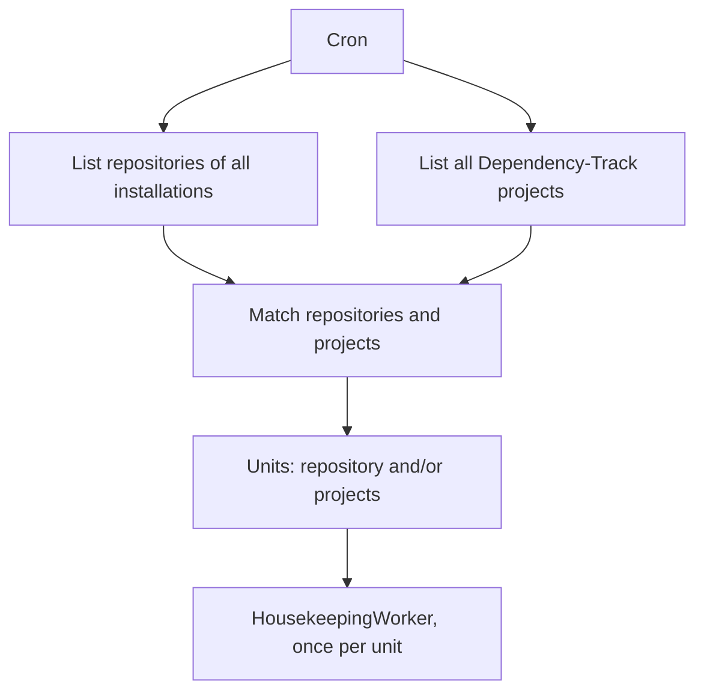

# Housekeeping

Besides reacting to GitHub webhook events, Technolinator can run a scheduled *housekeeping* across **all repositories of all installations** of its GitHub app and **all projects in Dependency-Track**.
It authenticates with the very same app credentials as the event handling, so no further secrets are needed and no webhook event is required.

The housekeeping is scheduled in-app, which is sufficient as long as Technolinator runs as a single replica.

## How a run works

A run is a **single walk-through**: every GitHub repository and every Dependency-Track project is looked at exactly once, and all housekeeping happens in one place, the `HousekeepingWorker`.



1. `GitHubRepositoryIndexer` lists the repositories of all non-suspended installations (installations in parallel), and `DependencyTrackClient` lists all projects (including archived ones). Both happen in parallel.
2. `UnitMatcher` pairs repositories with projects, using **the same matching as when uploading** (`RepositoryProjectMatcher`, which the event handling uses as well): a project belongs to a repository, if its name is the repository name or starts with `<repository>-`, and its VCS/website reference points to the repository (or it has no reference at all and is named exactly like the repository). Children of matched projects belong to the repository, too.
   On top of that, projects not matched to any repository follow their nearest matched ancestor in the Dependency-Track hierarchy, regardless of name and references, so a hierarchy is never split across units (Dependency-Track only archives parents without active children). A descendant matched to another repository on its own stays with that one.
3. Every result is a `HousekeepingUnit`, which is handed to the `HousekeepingWorker` exactly once. Units are processed in parallel (`APP_HOUSEKEEPING_WORKER_CONCURRENCY`).

### Units

| Unit                       | Repository state       | Meaning                                                                                                                         |
|----------------------------|------------------------|---------------------------------------------------------------------------------------------------------------------------------|
| repository and projects    | `ACTIVE` / `ARCHIVED`  | The regular case                                                                                                                |
| repository only            | `ACTIVE` / `ARCHIVED`  | The repository wasn't analyzed (yet), or its projects couldn't be matched                                                       |
| projects only              | `GONE`                 | The projects (or their nearest ancestor with a reference) reference exactly one repository, that certainly doesn't exist anymore |
| projects only              | `UNKNOWN`              | No repository could be matched and nothing can be said: no or several references, accounts without installation of the app, a repository existing but named differently, or projects claimed by more than one repository ("contested", including their descendants) |

A repository is considered `GONE` only if all of the following holds:

* its owner has an installation with access to *all repositories*, the repository list was non-empty and doesn't contain it
* GitHub doesn't know it when looked up on its own with that installation. GitHub keeps renamed and transferred repositories alive and redirects to them, so a repository missing in the list may well exist (and not be archived) under another name or owner. Only a plain "not found" counts, a redirect or a failing lookup makes it `UNKNOWN`
* no repository of the same name exists under another owner of the listings, which might be the transferred one

Repositories of installations restricted to *selected repositories* are never `GONE`: a deleted repository can't be told apart from a deselected one.
The lookup is only done for repositories referenced by active projects (or their ancestors), as only those can get projects archived. Repositories having archived projects only aren't looked up, which saves GitHub requests for long-gone repositories in every run, and are `UNKNOWN` therefore.

### Reliability of the listings

The absence of a repository or project only means something if everything was listed:

* **Dependency-Track** is all or nothing: if a page can't be fetched (after retries), or fewer projects are returned than `X-Total-Count` announces, the run is aborted without processing any unit.
* **GitHub** is checked per installation: an installation whose repositories can't be listed completely (request error, timeout, rate limit handling failing, or fewer repositories returned than GitHub announces via `total_count`) is logged, counted in `housekeeping_installation_failures` and left out, so its repositories are `UNKNOWN`.
* If **any** installation failed, the lists aren't trustworthy as a whole, so only units with *a repository and projects* are processed (a project might belong to a repository of the failed installation, a repository might have projects that are just not matched). Units with only a repository or only projects are skipped, and a warning tells how many units were processed. The same applies if a lookup of a manual, targeted run fails.

For big installations, repositories are listed with the maximum page size of 100. Each installation has its own rate limit (at least 5000 requests per hour), so a thousand repositories need 10 requests. The client waits for a primary rate limit to reset, which is bounded by `APP_HOUSEKEEPING_TIMEOUT`: the run is aborted without processing any unit if the listing doesn't finish in time.

`APP_ENABLED_REPOS` is applied (case-insensitively) to units, the per-repository `enable: false` of `.github/technolinator.yml` is **not** consulted.
With a filter set, projects without a repository reference are left out.

## Configuration

| Environment variable                         | Default       | Description                                                                                       |
|----------------------------------------------|---------------|---------------------------------------------------------------------------------------------------|
| `APP_HOUSEKEEPING_ENABLED`                   | `false`       | Switch of the scheduled run, the [manual trigger](#manual-trigger) works regardless               |
| `APP_HOUSEKEEPING_CRON`                      | `0 0 2 * * ?` | Quartz style cron expression, by default every night at 02:00                                     |
| `APP_HOUSEKEEPING_DRY_RUN`                   | `false`       | Actions must only log what they would do, instead of changing anything                            |
| `APP_HOUSEKEEPING_TIMEOUT`                   | `4H`          | Maximum duration of the whole run                                                                 |
| `APP_HOUSEKEEPING_TASK_TIMEOUT`              | `5M`          | Maximum duration of a single action invocation for a unit                                         |
| `APP_HOUSEKEEPING_INSTALLATION_CONCURRENCY`  | `4`           | Number of installations listed in parallel                                                        |
| `APP_HOUSEKEEPING_WORKER_CONCURRENCY`        | `4`           | Number of units processed in parallel                                                             |

Every action additionally has its own switch `app.housekeeping.<action-name>.enabled`; a run without any enabled action does nothing, not even listing.

## Manual trigger

A run can be started on demand with an HTTP endpoint, independent of `APP_HOUSEKEEPING_ENABLED`, which only switches the scheduled runs. So for manual runs only, leave it `false`; the actions are enabled by default.

```shell
# everything, like the scheduled run
curl -X POST http://localhost:8080/housekeeping

# only some repositories and/or Dependency-Track projects
curl -X POST 'http://localhost:8080/housekeeping?repository=my-org/my-repo,my-org/other-repo&project=my-project&project=0b8a3f1e-...'
```

| Query parameter | Meaning                                                                                                                     |
|-----------------|-----------------------------------------------------------------------------------------------------------------------------|
| `repository`    | Repository including its owner (`owner/repo`). Also works for repositories that don't exist anymore, as long as projects reference them |
| `project`       | Dependency-Track project by exact name (any version) or UUID                                                                |

Both are optional, repeatable and may be comma separated lists; matching is case-insensitive. Without any, everything is processed.
Up to 100 repositories and projects can be selected in total, as each is looked up on its own; beyond that, run for everything instead.
The worker always handles whole units, so selecting a project selects its repository and all projects belonging to it, too, and selecting a repository selects all of its projects.
Selected names that don't match anything are logged as a warning. `APP_ENABLED_REPOS`, dry-run mode and all action switches and limits apply as usual.

A run with a selection is **targeted**: it neither lists all repositories of all installations nor all Dependency-Track projects. Instead

* the installations are listed (cheap), but only the named repositories are fetched, each one from the installation of its owner. A repository that's not found there counts as gone, a renamed/transferred one, an owner without an active installation or a failing lookup as unknown, so nothing is archived on that basis.
* selected projects are fetched by UUID or searched by name, together with their parents and children.
* the projects of a repository are searched by the repository's name, and matched like in the full run, including the ones referencing the repository under another name.

Limitations compared to the full run: a project of a repository that has a different name and no matching reference isn't found; and projects with the repository's name but no references, belonging to a different owner, can't be told apart (the same as for the event handling).

The run happens in the background, the response is immediate:

| Status | Meaning                                                                                      |
|--------|----------------------------------------------------------------------------------------------|
| `202`  | Run started                                                                                  |
| `400`  | `repository` or `project` given without any value (to not accidentally run for everything), a repository without owner, or more than 100 selected in total |
| `409`  | No action is enabled, or a run is already in progress                                        |

A partial run doesn't update the gauges `housekeeping_last_completed_epoch_seconds` and `housekeeping_last_success_epoch_seconds`, as they tell about complete runs.

> **The endpoint is not protected.** Anyone who can reach it can trigger actions that change Dependency-Track (like archiving projects). Don't expose it beyond the trusted network, e.g. by not routing `/housekeeping` through the ingress.

## Observability

* `housekeeping_action{action, status}` counts action invocations per outcome (`OK`, `ERROR`)
* `housekeeping_installation_failures` counts installations whose repositories couldn't be listed
* `housekeeping_run_duration` timer
* `housekeeping_last_completed_epoch_seconds` gauge: last run that listed everything and handed every unit to the worker, regardless of failures within the units. Best suited for alerting on missed or aborted (listing failed, timeout) runs.
* `housekeeping_last_success_epoch_seconds` gauge: last run without any failure, i.e. additionally no failed installation and no failed unit. A single persistent problem keeps it from advancing, so prefer alerting on `housekeeping_last_completed_epoch_seconds` and on increases of `housekeeping_action{status="ERROR"}` and `housekeeping_installation_failures`.

Failures are isolated per unit and action: they're logged and counted, but never abort the run.
All log lines of one run share its `traceId`; the final log line contains the summary (installations, repositories, projects, units by kind, failures).
Units in flight when the run timeout elapses aren't interrupted.

### Structured action log

Every piece of work an action acted on gets one log line tagged `HOUSEKEEPING_ACTION`, in the same `key=value` style as the `GITHUB_REPORT` lines, for building dashboards on top of the logs:

```
HOUSEKEEPING_ACTION action=archive_orphaned_projects status=done repository=my-org/my-repo repository_state=archived project=0b8a3f1e-... name=my-repo version=main
```

| Key                | Values                                                                                                          |
|--------------------|-----------------------------------------------------------------------------------------------------------------|
| `action`           | `archive_orphaned_projects`, `reactivate_projects`, `update_project_metadata` (the action name with underscores) |
| `status`           | `done`, `dry_run` (would have been done), `failed`                                                              |
| `repository`       | `owner/repo`, `-` for units without a repository (gone or unknown)                                              |
| `repository_state` | `active`, `archived`, `gone`, `unknown`                                                                         |
| `project`, `name`, `version` | the Dependency-Track project acted on, `-` if the failure isn't related to a single project            |

One line is written per project archived, reactivated or updated, or whose change failed. A failure that isn't related to a single project (e.g. the action timeout, or GitHub failing to deliver the topics) is written once per unit and action with `project=-`.
Nothing is written for what was not acted on: units the action doesn't apply to, projects already up to date, or skipped by a limit or safeguard.
Values containing whitespace, quotes or `=` are quoted. The lines carry the `traceId` of the run (and the `repository` where known) in the log context, so they can be tied to the run and its summary. `failed` lines are logged as warnings, the others as info.

## Adding housekeeping

All housekeeping lives in `HousekeepingWorker`. An action is an entry in the list built in its constructor:

```java
new Action("my-action", () -> myActionEnabled, this::appliesToMyAction, this::myAction)
```

* `name` is used for the metric and logs, and by convention for the switch `app.housekeeping.my-action.enabled` (inject it as `@ConfigProperty` in the constructor and add it to `application.properties`)
* `applies` decides from the `HousekeepingUnit` (repository, projects, repository state), whether the action is of interest
* `work` performs it. It runs on a worker thread, so blocking calls are fine, and has to respect `unit.dryRun()`. A failed `Uni` is logged, counted as `ERROR` and doesn't affect other actions or units.
  It should write a `HousekeepingActionLog` line for every project it changes (or would change in dry-run mode), see [Structured action log](#structured-action-log).

Actions only get to see one unit at a time, but may keep per-run state keyed by `HousekeepingRun#id()` (see `begin`/`end` of the worker).
`GitHubRepo#github()` returns a GitHub client authenticated as the installation of the repository. The `GHRepository` held in `GitHubRepo#listed` is bound to a token that may expire during a long run, so use `github()` for later writes.
Actions writing to GitHub may require additional permissions for the GitHub app, see [Adoption](Adoption.md#github-app-requirements).

## Action `archive-orphaned-projects`

Archives (deactivates) Dependency-Track projects, whose GitHub repository doesn't exist anymore or got archived.
It applies to units with repository state `ARCHIVED` or `GONE` and at least one active project.

| Environment variable                                     | Default | Description                                                                                    |
|----------------------------------------------------------|---------|------------------------------------------------------------------------------------------------|
| `APP_HOUSEKEEPING_ARCHIVE_ORPHANED_PROJECTS_ENABLED`     | `true`  | Action switch. Runs only happen if triggered manually or `APP_HOUSEKEEPING_ENABLED` schedules them |
| `APP_HOUSEKEEPING_ARCHIVE_ORPHANED_PROJECTS_MAX_PER_RUN` | `500`   | Upper limit of projects archived per run, as protection against mass-archiving by faulty data. Checked per unit, so the last repository's projects might exceed it |

Safeguards:

* Projects are archived **children before parents** (Dependency-Track rejects archiving a parent with active children). If a project fails to be archived, the remaining ones of the unit are left for the next run.
  This keeps failing for a parent having an active child that belongs to another, still active, repository; resolve such hierarchies manually.
* Units with a project having a BOM import after the run started are skipped, they might belong to a brand-new repository.
* `UNKNOWN` units are never touched: projects without or with several references, owners without installation, contested projects, projects of existing repositories that couldn't be matched.
* Already archived projects are left alone.

Archiving is reversible: the next BOM upload for the project reactivates it, e.g. when the repository was only temporarily unavailable or got renamed back.
A repository renamed without Technolinator having seen the event keeps its old projects: they're `UNKNOWN`, as the repository isn't gone, and the next analysis creates or reactivates the projects under the new name.
The action honors dry-run mode, which only logs the projects that would be archived.

## Action `update-project-metadata`

Backfills the external references and tags of Dependency-Track projects, the way the BOM upload sets them (`PATCH /project/{uuid}`), for projects created before Technolinator did so, e.g. the `owner=<owner>` tag.
It applies to units with an `ACTIVE` repository and projects.

| Environment variable                                       | Default | Description                                                                                    |
|------------------------------------------------------------|---------|------------------------------------------------------------------------------------------------|
| `APP_HOUSEKEEPING_UPDATE_PROJECT_METADATA_ENABLED`         | `true`  | Action switch. Runs only happen if triggered manually or `APP_HOUSEKEEPING_ENABLED` schedules them |
| `APP_HOUSEKEEPING_UPDATE_PROJECT_METADATA_MAX_PER_RUN`     | `1000`  | Upper limit of projects looked at per run, which spreads the backfill over multiple runs. Checked per unit, so the last repository's projects might exceed it |

Which projects: only the ones *definitely* belonging to the repository, decided by the same rules as for repository events (`RepositoryProjectMatcher`):
projects referencing the repository (VCS or website), projects named exactly like the repository while having no repository reference at all, and children of these named `<repository>-...`.
As the project doesn't have any relation to the GitHub organization in Dependency-Track, this relies on the name, and projects of same-named repositories of different installations are left alone (contested, see `UnitMatcher`).
Archived projects, projects of archived repositories and `UNKNOWN` units aren't touched.

What is set:

* **References:** VCS (git URL), website (HTML URL) and release notes (`<website>/releases`) of the repository, replacing the ones of these types. References of other types are kept.
* **Tags:** `owner=<owner>` and the GitHub topics of the repository. Tags of the form `key=value` are kept (`sbom-quality-score=...` and the backstage annotations, which the upload derives from the BOM analysis and `catalog-info.yaml`, neither being available to housekeeping). Other tags are replaced, as GitHub topics can't contain `=`.
* Nothing else: description, state and parent of the project stay as they are, so archived versions don't get reactivated.

Safeguards and costs:

* Only projects lacking one of the references or the owner tag are looked at. GitHub is asked for the topics (2 requests per repository, with the installation's rate limit in mind) only if there's such a project, so a run after the backfill is for free. Topics changed on GitHub reach the projects with their next BOM upload.
* Before updating, the project is fetched again, so tags changed meanwhile (e.g. by an upload during the run) aren't overwritten.
* The action honors dry-run mode, which still reads the topics from GitHub, but only logs the projects that would be updated.

## Action `reactivate-projects`

The counterpart of `archive-orphaned-projects`: reactivates archived Dependency-Track projects of repositories that are `ACTIVE` (existing and not archived).
It repairs projects archived by mistake, e.g. by faulty repository data, or whose repository got unarchived since.
It applies to units with an `ACTIVE` repository and at least one archived project.

| Environment variable                                   | Default | Description                                                                                    |
|--------------------------------------------------------|---------|------------------------------------------------------------------------------------------------|
| `APP_HOUSEKEEPING_REACTIVATE_PROJECTS_ENABLED`         | `true`  | Action switch. Runs only happen if triggered manually or `APP_HOUSEKEEPING_ENABLED` schedules them |
| `APP_HOUSEKEEPING_REACTIVATE_PROJECTS_MAX_PER_RUN`     | `500`   | Upper limit of projects reactivated per run. Checked per unit, so the last repository's projects might exceed it |

Which projects: only the ones *definitely* belonging to the repository, same rules as for `update-project-metadata`, and additionally:

* Old versions stay archived: the BOM upload archives all other versions of a project, so only one version per project name is expected to be active. Hence nothing is reactivated if a version of the same name is active already.
* Of several archived versions with the same name, the one with the latest BOM import is reactivated. If none of them has a BOM import, it can't be told and they're left alone.
* **Parents are reactivated before their children**. If a project fails, its children (and the remaining ones of the unit) are left for the next run. Children of a parent staying archived (e.g. an old version superseded by an active one) stay archived as well.

Limitations:

* Projects of *renamed* repositories keep their old name and old references, so they don't match the repository anymore. They're `UNKNOWN` and not reactivated, but the next BOM upload under the new name creates or reactivates the projects.
* The action can't tell archiving by mistake from archiving on purpose: projects archived manually while their repository is active are reactivated, too. Once the repair is done, consider switching the action off.
* The project listing is taken at the start of the run, so a concurrent BOM upload might race with it. Both leave the project active.

The action honors dry-run mode, which only logs the projects that would be reactivated. Recommended for the first run.
