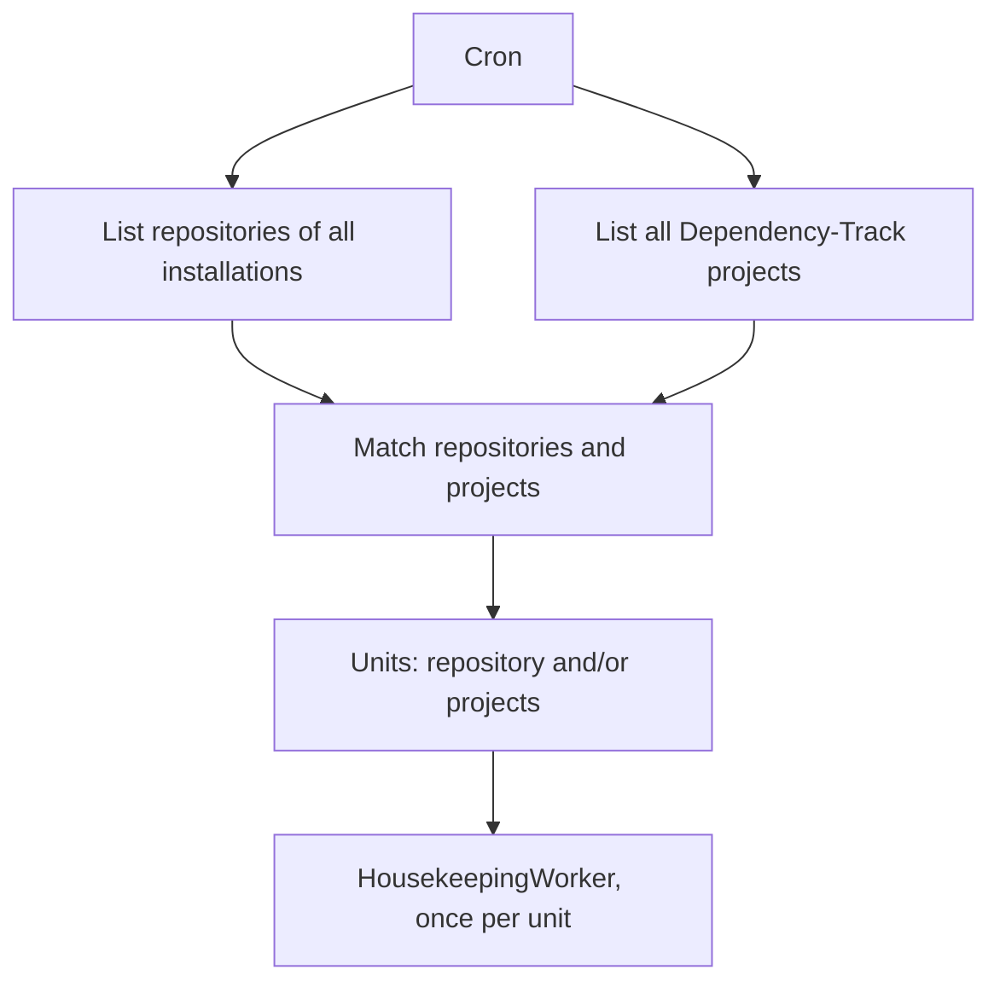

# Housekeeping

Besides reacting to GitHub webhook events, Technolinator can run a scheduled *housekeeping* across **all repositories of all installations** of its GitHub app and **all projects in Dependency-Track**.
It authenticates with the very same app credentials as the event handling, so no further secrets are needed and no webhook event is required.

The housekeeping is scheduled in-app, which is sufficient as long as Technolinator runs as a single replica.

## How a run works

A run is a **single walk-through**: every GitHub repository and every Dependency-Track project is looked at exactly once, and all housekeeping happens in one place, the `HousekeepingWorker`.



1. `GitHubRepositoryIndexer` lists the repositories of all non-suspended installations (installations in parallel), and `DependencyTrackClient` lists all projects (including archived ones). Both happen in parallel.
2. `UnitMatcher` pairs repositories with projects, using **the same matching as when uploading** (`RepositoryProjectMatcher`, which the event handling uses as well): a project belongs to a repository, if its name is the repository name or starts with `<repository>-`, and its VCS/website reference points to the repository (or it has no reference at all and is named exactly like the repository). Children of matched projects belong to the repository, too.
   On top of that, projects not matched to any repository follow their nearest matched ancestor in the Dependency-Track hierarchy, regardless of name and references, so a hierarchy is never split across units (Dependency-Track only archives parents without active children). A descendant matched to another repository on its own stays with that one.
3. Every result is a `HousekeepingUnit`, which is handed to the `HousekeepingWorker` exactly once. Units are processed in parallel (`APP_HOUSEKEEPING_WORKER_CONCURRENCY`).

### Units

| Unit                       | Repository state       | Meaning                                                                                                                         |
|----------------------------|------------------------|---------------------------------------------------------------------------------------------------------------------------------|
| repository and projects    | `ACTIVE` / `ARCHIVED`  | The regular case                                                                                                                |
| repository only            | `ACTIVE` / `ARCHIVED`  | The repository wasn't analyzed (yet), or its projects couldn't be matched                                                       |
| projects only              | `GONE`                 | The projects (or their nearest ancestor with a reference) reference exactly one repository, that certainly doesn't exist anymore |
| projects only              | `UNKNOWN`              | No repository could be matched and nothing can be said: no or several references, accounts without installation of the app, a repository existing but named differently, or projects claimed by more than one repository ("contested", including their descendants) |

A repository is considered `GONE` only if its owner has an installation with access to *all repositories*, the repository list was non-empty and doesn't contain it.
Repositories of installations restricted to *selected repositories* are never `GONE`: a deleted repository can't be told apart from a deselected one.

`APP_ENABLED_REPOS` is applied (case-insensitively) to units, the per-repository `enable: false` of `.github/technolinator.yml` is **not** consulted.
With a filter set, projects without a repository reference are left out.

## Configuration

| Environment variable                         | Default       | Description                                                                                       |
|----------------------------------------------|---------------|---------------------------------------------------------------------------------------------------|
| `APP_HOUSEKEEPING_ENABLED`                   | `false`       | Main switch                                                                                       |
| `APP_HOUSEKEEPING_CRON`                      | `0 0 2 * * ?` | Quartz style cron expression, by default every night at 02:00                                     |
| `APP_HOUSEKEEPING_DRY_RUN`                   | `false`       | Actions must only log what they would do, instead of changing anything                            |
| `APP_HOUSEKEEPING_TIMEOUT`                   | `4H`          | Maximum duration of the whole run                                                                 |
| `APP_HOUSEKEEPING_TASK_TIMEOUT`              | `5M`          | Maximum duration of a single action invocation for a unit                                         |
| `APP_HOUSEKEEPING_INSTALLATION_CONCURRENCY`  | `4`           | Number of installations listed in parallel                                                        |
| `APP_HOUSEKEEPING_WORKER_CONCURRENCY`        | `4`           | Number of units processed in parallel                                                             |

Every action additionally has its own switch `app.housekeeping.<action-name>.enabled`; a run without any enabled action does nothing, not even listing.

## Observability

* `housekeeping_action{action, status}` counts action invocations per outcome (`OK`, `ERROR`)
* `housekeeping_installation_failures` counts installations whose repositories couldn't be listed
* `housekeeping_run_duration` timer
* `housekeeping_last_completed_epoch_seconds` gauge: last run that listed everything and handed every unit to the worker, regardless of failures within the units. Best suited for alerting on missed or aborted (listing failed, timeout) runs.
* `housekeeping_last_success_epoch_seconds` gauge: last run without any failure, i.e. additionally no failed installation and no failed unit. A single persistent problem keeps it from advancing, so prefer alerting on `housekeeping_last_completed_epoch_seconds` and on increases of `housekeeping_action{status="ERROR"}` and `housekeeping_installation_failures`.

Failures are isolated per unit and action: they're logged and counted, but never abort the run.
All log lines of one run share its `traceId`; the final log line contains the summary (installations, repositories, projects, units by kind, failures).
Units in flight when the run timeout elapses aren't interrupted.

## Adding housekeeping

All housekeeping lives in `HousekeepingWorker`. An action is an entry in the list built in its constructor:

```java
new Action("my-action", () -> myActionEnabled, this::appliesToMyAction, this::myAction)
```

* `name` is used for the metric and logs, and by convention for the switch `app.housekeeping.my-action.enabled` (inject it as `@ConfigProperty` in the constructor and add it to `application.properties`)
* `applies` decides from the `HousekeepingUnit` (repository, projects, repository state), whether the action is of interest
* `work` performs it. It runs on a worker thread, so blocking calls are fine, and has to respect `unit.dryRun()`. A failed `Uni` is logged, counted as `ERROR` and doesn't affect other actions or units.

Actions only get to see one unit at a time, but may keep per-run state keyed by `HousekeepingRun#id()` (see `begin`/`end` of the worker).
`GitHubRepo#github()` returns a GitHub client authenticated as the installation of the repository. The `GHRepository` held in `GitHubRepo#listed` is bound to a token that may expire during a long run, so use `github()` for later writes.
Actions writing to GitHub may require additional permissions for the GitHub app, see [Adoption](Adoption.md#github-app-requirements).

## Action `archive-orphaned-projects`

Archives (deactivates) Dependency-Track projects, whose GitHub repository doesn't exist anymore or got archived.
It applies to units with repository state `ARCHIVED` or `GONE` and at least one active project.

| Environment variable                                     | Default | Description                                                                                    |
|----------------------------------------------------------|---------|------------------------------------------------------------------------------------------------|
| `APP_HOUSEKEEPING_ARCHIVE_ORPHANED_PROJECTS_ENABLED`     | `false` | Action switch                                                                                  |
| `APP_HOUSEKEEPING_ARCHIVE_ORPHANED_PROJECTS_MAX_PER_RUN` | `500`   | Upper limit of projects archived per run, as protection against mass-archiving by faulty data. Checked per unit, so the last repository's projects might exceed it |

Safeguards:

* Projects are archived **children before parents** (Dependency-Track rejects archiving a parent with active children). If a project fails to be archived, the remaining ones of the unit are left for the next run.
  This keeps failing for a parent having an active child that belongs to another, still active, repository; resolve such hierarchies manually.
* Units with a project having a BOM import after the run started are skipped, they might belong to a brand-new repository.
* `UNKNOWN` units are never touched: projects without or with several references, owners without installation, contested projects, projects of existing repositories that couldn't be matched.
* Already archived projects are left alone.

Archiving is reversible: the next BOM upload for the project reactivates it, e.g. when the repository was only temporarily unavailable or got renamed back.
A repository renamed without Technolinator having seen the event gets its old projects archived; the next analysis creates or reactivates the projects under the new name.
The action honors dry-run mode, which only logs the projects that would be archived.
