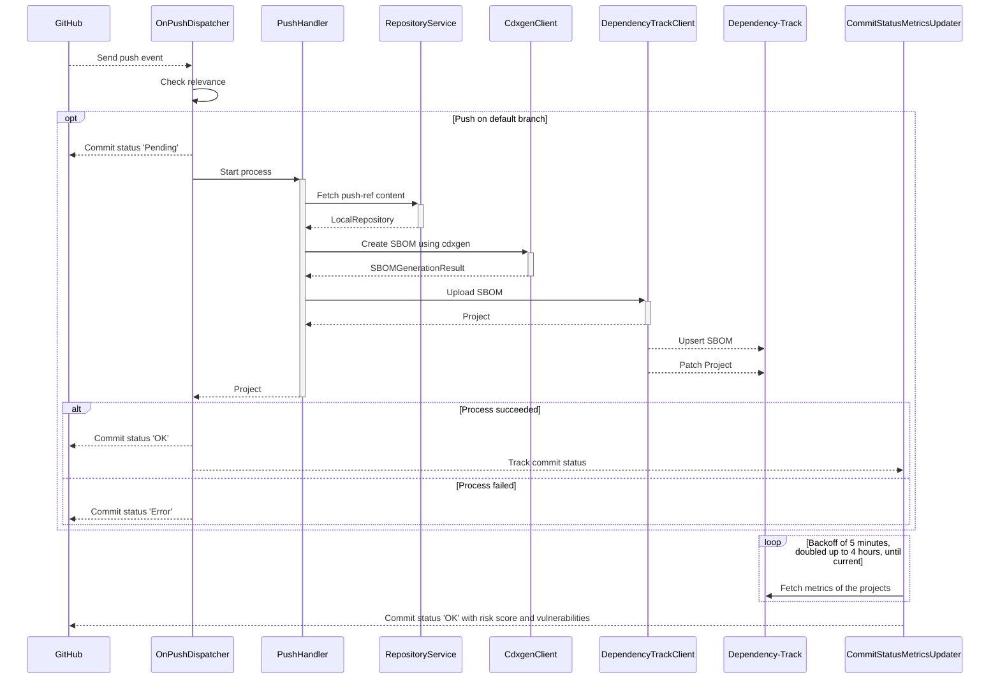
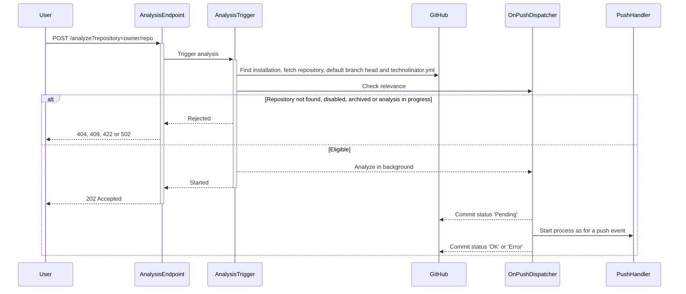
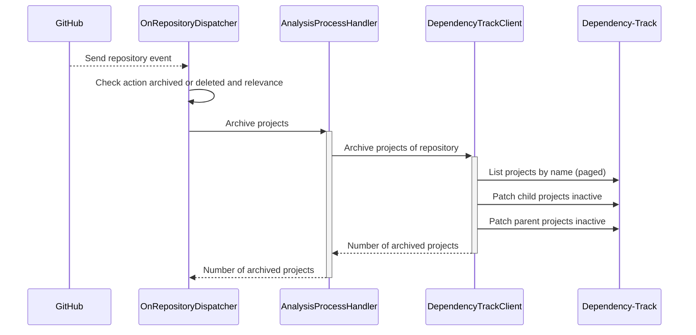

# Inside Technolinator

_to be updated_

## Process overview

The commit status of **pull-requests** tells about the vulnerabilities the analysis found, see [Commit status](Analysis.md#commit-status): `OnPullRequestDispatcher` writes `pending` before the analysis, and `success` or `failure` after it, from the `AnalysisOutcome` of the analysis handler, which sums up the numbers per severity stated by the vulnerability reports of the SBOMs.

## Manual analysis

Besides push events, an analysis can be started on demand with `POST /analyze?repository=owner/repo`, see [Analysis](Analysis.md#manual-analysis). `AnalysisEndpoint` hands the request to `AnalysisTrigger`, which looks up the repository with the installation of the GitHub app, reads its `technolinator.yml` and the head of the default branch, and then runs the very same steps as for a push event by calling `OnPushDispatcher` (`eligibility()` and `analyze()`), so everything from `PushHandler` on is shared.

## Archiving

When a repository gets archived or deleted on GitHub, all of its Dependency-Track projects are archived (deactivated) as well.
A deleted repository can't be asked for its `technolinator.yml` anymore, so `enable: false` is not honoured in that case; `APP_ENABLED_REPOS` still applies.
Projects are matched by name and by the repositories VCS or website URL; children of multi-module projects are archived before their parents.
Projects lacking external references (e.g. not created by Technolinator) are matched by their exact name, and their multi-module children via the parent relation. Projects referencing a different repository are never archived.
The `repository` event requires the GitHub App to be subscribed to the *Repository* event.

