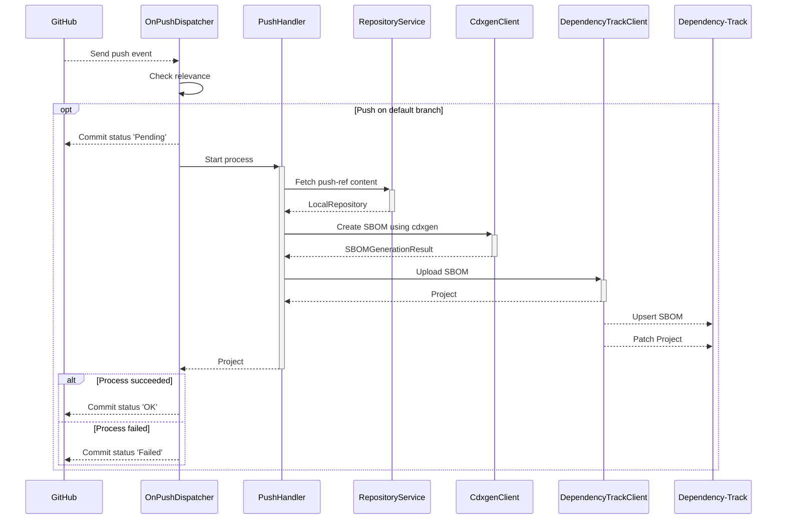

# Inside Technolinator

_to be updated_

## Process overview

## Archiving

When a repository gets archived on GitHub, all of its Dependency-Track projects are archived (deactivated) as well.
Projects are matched by name and by the repositories VCS or website URL; children of multi-module projects are archived before their parents.
Projects lacking external references (e.g. not created by Technolinator) are matched by their exact name, and their multi-module children via the parent relation. Projects referencing a different repository are never archived.
The `repository` event requires the GitHub App to be subscribed to the *Repository* event.

